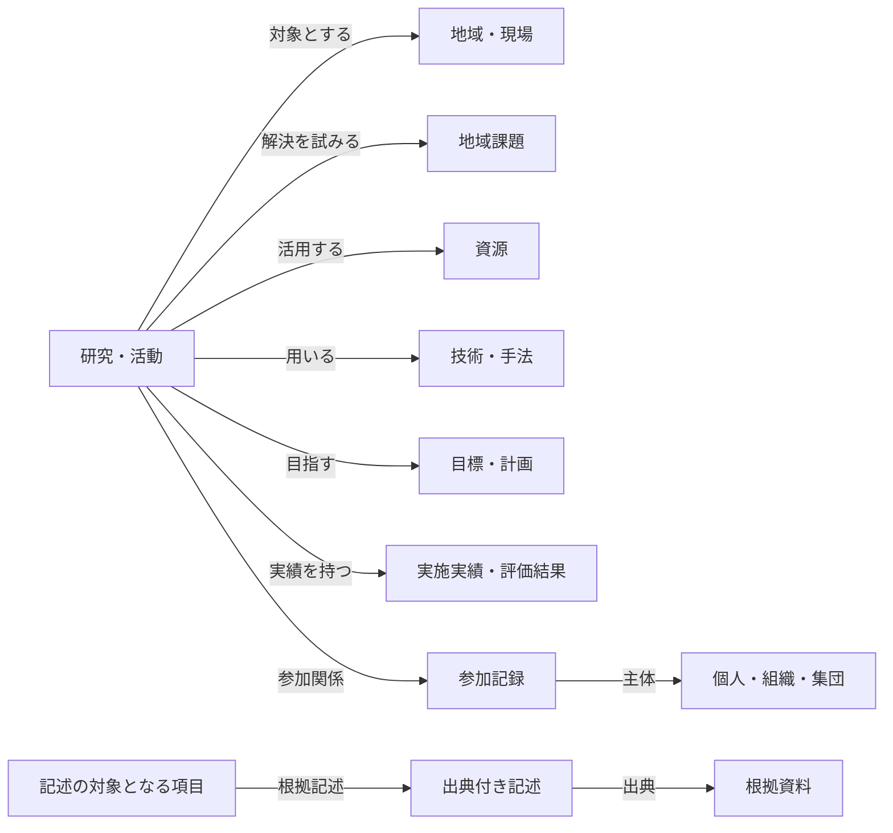

# 卒論の概念整理を踏まえたデータベース設計

更新日：2026年11月4日

この更新は、卒論現稿の第2章2.4「離島工学を構成する概念と関係」と2.5「知識基盤の設計に向けた整理」を、現在のRDFデータベース設計へ反映するものである。事例を追加する更新ではない。前の作業で追加した4事例とその関連データは取り消し、`data/knowledge.ttl`と既存Wikiを更新前の状態に戻した。

卒論の原則と、本実装における具体化を区別する。卒論本文では、具体的なRDFデータ構造は次章で検討するとされているため、以下のクラス名、述語名、必須項目は今回の実装上の設計判断である。卒論中に既に確定した仕様とみなすものではない。

## 設計の中心

研究・活動を、地域・現場、課題、主体、資源、技術・手法、目標・成果と関連付ける。教育・地域連携・地域の対応力は、これらの関係を読む観点として扱い、すべての事例に機械的に分類ラベルを付与する設計にはしない。

## クラスの見直し

| クラス | 設計上の役割・既存構造からの変更 |
| --- | --- |
| Research | 研究だけでなく教室や支援活動も含む「研究・活動」とする。既存IDを維持する |
| Target | 課題や活動の対象となる地域・現場。地域名と施設名は名称・説明で区別し、未確認の地域へ自動展開しない |
| Issue | 対応が求められる問題。背景条件も記録する |
| User | 既存の個人クラス。個人名不明の学生集団を架空のユーザとして登録しない |
| Laboratory | 研究室に限らず学校・自治体・運営組織を含める。互換性のため既存IDを維持する |
| ActorGroup | 学生集団・住民集団など。個人や「学生」という身分と区別する |
| Resource | 設備・材料・知識・技能など、活用する対象。新設 |
| Technology | 調査・加工・組合せ・指導など、資源に用いる方法 |
| Participation | 一つの活動と一つの主体を、活動内の役割で結ぶ記録。新設 |
| Goal | 実現を目指す状態、開発計画、利用構想。新設 |
| Result | 実施実績または評価結果。`種別`で両者を区別する。新設 |
| Source | 根拠資料。タイトル・発行時点・資料パス等を持つ。新設 |
| Evidence | 一つの記述と、その出典・該当箇所・時点・確認状況を対応付ける記録。新設 |

Status（学生・教員等）、Article、ExternalLinkは従来の役割を維持する。「学生」は身分、特定活動の「講師」は役割、学生の指導する力は資源という別々の対象として表す。設備とその開発プロジェクトも別項目とする。

## 関係の見直し

| 主語 | 述語 | 目的語 |
| --- | --- | --- |
| Research | 対象とする | Target |
| Research | 解決を試みる | Issue |
| Research | 活用する | Resource |
| Research | 用いる | Technology |
| Research | 目指す | Goal |
| Research | 実績を持つ | Result |
| User / Laboratory / ActorGroup | 担当する | Research |
| User / Laboratory | 所属する | Laboratory |
| Participation | 活動 | Research |
| Participation | 主体 | User / Laboratory / ActorGroup |
| Resource | 構成要素 / 加工先 / 用途 | Resource |
| Evidence | 記述対象 | 記述の主語となる項目 |
| Evidence | 出典 / 原資料 | Source |
| Evidence | 関係先 | 記述の目的語となる項目 |

従来の`扱う`は「個人が研究を担当する」と「研究が技術を用いる」の二つを兼ねていた。新規の入力では`担当する`と`用いる`に分ける。既存トリプルを一括変換せず、画面は旧述語も読み取る。

`所属する`は個人の所属と組織同士の所属に共通して使う。例えば「個人 → 研究室 → 学科 → 大学」を表せる。複数の所属先を登録できるが、組織の自己所属・循環は保存時に拒否する。組織ページで直接の所属先・所属組織・所属メンバーを表示し、所属先を編集できる。上位組織への個人の所属を自動追加せず、活動や記事の集計範囲も自動では拡張しない。

メインメニューの「組織・研究室」から組織一覧・新規追加に進める。組織ページの「組織情報を編集」では、名称・概要・所属先・関連リンクを編集する。旧形式の詳しい紹介は概要欄にまとめて表示し、保存時に概要へ統合する。保存先は `POST /api/portfolio/organization`。名称変更はタイトルのみを更新し、既存ID・所属メンバー・別途登録した関係を保持する。所属関係は基本情報の直下に表示する。組織の参加活動は、主体がその組織である参加記録や「担当する」から取得する。

`構成要素`は設備同士の構成を表す。研究プロジェクトから装置へは`活用する`で結ぶ。構成や加工が将来構想にすぎない場合は、その関係を確定した事実として直接追加せず、次の出典付き記述に記録する。

## 出典は記述の単位で保持する

項目全体に出典を一つ付けるだけでは、装置構成、進捗、将来計画のそれぞれを何が裏付けるか識別できない。そこでEvidenceには以下を持たせる。

| 項目 | 役割 |
| --- | --- |
| 記述対象 | 何についての記述か。1項目 |
| 対象述語 | どの関係・属性についてか。スキーマに定義された述語名を文字列で保持 |
| 関係先 / 値 | 記述内容の目的語。項目への参照または文字列の一方を1つだけ記録 |
| 出典 | 直接参照して確認したSource。必須 |
| 原資料 | 二次資料が参照する原資料。必要な場合のみ。直接確認した証拠にはしない |
| 該当箇所 | 出典内のページ・節・図表等。必須 |
| 記述区分 | 資料の説明、本研究の整理、目標、計画、実施状況、実施実績、評価結果 |
| 確認状況 | 未確認、原資料確認済み、二次資料で確認、追加確認が必要 |
| 活動時期 | 資料が述べる活動の時期 |
| 記録時点 | データベースに記録・確認した時点 |

資料自体の発行時点はSourceに置き、活動時期・記録時点と混同しない。時点は年・年度・期間・不明を表現できる文字列とし、分からない月日を補わない。

Evidenceを保存しても、`記述対象 → 対象述語 → 関係先/値`を自動的に事実として追加しない。これにより、目標・計画も、安全に出典と対応付けられる。直接関係とEvidenceの照合・自動同期は今後の検討事項とする。

進捗を更新する際は、`対象述語=実施状況`のEvidenceを時点ごとに追加する。同じIDの記録を書き換えると履歴は残らないため、別時点には別IDを付ける。実施実績と効果の評価結果も別記録とする。

## 実装との対応

- `data/schema.json`：クラス、関係の始点・終点、文字属性、選択肢、必須項目を持つ共通の設計定義。事例データとは分離する。
- `data/knowledge.ttl`：従来の事例データを保持する。旧形式のクラス宣言も互換性のため残す。今回、新しい事例は投入しない。
- `rdf_manager.py`：設計定義を読み込み、登録時の種類・関係先・必須項目を検証する。Participationから活動への索引、Evidenceから記述対象への索引を同期する。
- `GET /api/schema`：画面や外部処理から設計定義を取得する。
- `POST /api/entity`：`attributes`で文字属性、`relations`で項目間の関係を登録する。未入力の概要・Wiki・リンクを自動的に消さない。
- 登録・編集画面：スキーマに応じた関連先・文字属性の入力欄を生成する。出典付き記述や役割も画面から登録できる。
- 関係の置換：`replace_predicates`でフォームが編集する述語だけを指定する。研究の編集で別途登録した出典や役割を消さない。
- Turtle直接保存：構文に加え、登録データのスキーマ制約も検証する。
- 削除：参照先の削除で出典・参加記録の必須項目が欠ける場合、保存を拒否する。
- AI探索：関連する記述・資料・役割と文字属性を検索コンテキストに含め、計画・実績・評価を区別する。

スキーマはアプリ独自の軽量な検証定義であり、RDFS推論やSHACL検証を実装したものではない。外部の標準語彙への対応付け、利用者認証と人物の分離、日付の型付け、直接関係と根拠記述の整合性管理は今後の設計課題として残る。

## 検証

` .venv/bin/python -m unittest discover -s tests -v `で12件のテストを実施した。資源と技術の取り違え、役割記録の必須項目、記述と出典の対応、計画を直接事実化しないこと、時点別記録の共存、編集時の情報保持、不完全なTurtleと参照先削除の拒否、文字列の再読込、APIの応答を確認している。

JavaScript構文と、8種類のスキーマ入力欄・カテゴリの生成処理も確認した。ブラウザ上の見た目とOllamaによる実際の文章生成は未検証。

`data/knowledge.ttl`が更新前のバックアップとバイト単位で一致することを確認した。前の作業で誤って追加したデータは`data/backups/misinterpreted-thesis-import/`へ退避し、通常のデータ読込対象から外した。

## 研究・実践記事からの実績・評価の整理

記事本文から選択した引用を、研究に属するResultの説明とEvidenceの値として保存する。Evidenceの出典は、元のArticleを「原記事」で参照するSource。Sourceには「記事版」（既存の記事revisionと同じSHA-256）、「資料区分：記事記録」、保存時点の本文を保持する。記事の編集や研究概要の自動更新は行わない。

登録時には、記事が対象の研究に紐付く研究・実践記事であること、版が最新であること、引用が本文に存在することを検証する。同一の記事版・研究・引用・種類・活動時期の再送は一件として扱う。記事の記述だけを根拠に、外部資料で確認済みの記述は作らない。記事の版が変わった場合も、以前のSourceの本文は置換しない。
